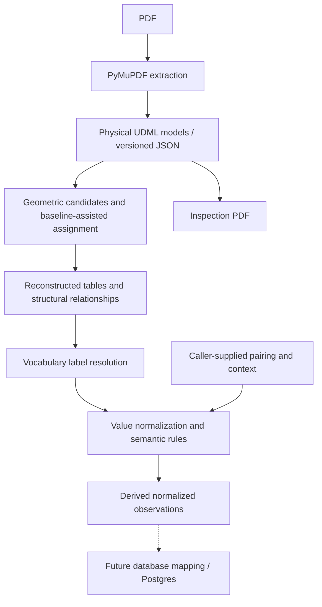

# UDML

UDML is a Python 3.12+ prototype. It converts PDFs into a reusable, provenance-preserving document model, then derives structure and common semantic observations independently of any database schema.

## Architecture



Inspection draws stored geometry; it is not a second extraction. Pairing and context reach normalization only when a caller supplies them. The dashed branch is not implemented. Global reading order, automatic context linking, and borderless table reconstruction are not part of this flow.

## Layer boundaries

**Physical schema 0.5.0** (`udml.core`) stores pages, text spans and parser origins, source lines and blocks, line orientation, selected straight vector segments, the source hash, parser name and version, extraction time, warnings, and limitations. Coordinates are PDF points from the top-left of the unrotated page: x increases right and y increases down. Rotation is stored separately as 0, 90, 180, or 270. Span, line, and block order follow parser source order. Unknown fields are rejected. Any other `schema_version` is refused.

**Derived structure** (`udml.structure`) builds provisional ruled-grid candidates, assigns spans by box containment or an optional baseline fallback, and reconstructs cells with structural and candidate relationships. A baseline assignment means the baseline lies inside one cell. It does not show that glyph ink lies inside that cell. These objects are candidates, not confirmed tables.

**Semantic vocabulary 0.2.0** (`udml.semantic`) defines four concepts: assets under management, expense ratio, net asset value, and portfolio weight. Qualifiers, `Decimal` amounts, unit kind, currency denomination, and scale stay separate. A percent stays in percentage points. `ContextClaim` keeps the document hash, page, span ids, original text, and the caller’s interpretation, and checks those span ids against the document. Named rules, including `nav-currency-per-unit-v1` and `aum-as-on-point-in-time-v1`, record inference as method `concept-definition-v1`. Their evidence text is the rule id.

Physical facts, derived candidates, caller claims, and semantic inference stay distinguishable.

## Example

On the HDFC factsheet, “EXPENSE RATIO” paired with “Regular: 1.27%” normalizes to `expense_ratio`, amount `Decimal("1.27")`, unit `percent`, and plan `regular` from the “Regular:” prefix. Scheme scope and the as-of date were supplied by a caller using source references: the fund-heading span and the section note “(As On September 30, 2026)”. That date is the disclosure date. `effective_date` stays absent. This is an in-memory result, not a serialized API format.

## Verification

These checks are not a complete visual review, exhaustive coverage, or an independent financial validation.

- An earlier schema 0.4.0 review covered 531 pages. Hashes matched, and extraction was reproducible under the parser version recorded on those documents.
- Schema 0.5.0 was exercised by parsing three development PDFs in memory. Saved 0.4.0 JSON is not migrated.
- The latest focused suite, as reported, passed 15 tests for table reconstruction, label resolution, and normalization. Ruff passed on that run.
- Three real observations resolved with caller-supplied pairing and context: an Edelweiss NAV, an HDFC assets-under-management amount, and the HDFC expense ratio above.

## Current limitations

- Ruled-grid detection and header candidates are provisional and use uncalibrated tolerances.
- Global reading order is absent. Reliable borderless and merged-table reconstruction is absent.
- Automatic semantic context linking is absent.
- Dict-based caller context stores the supplied token and does not validate source spans. `ContextClaim` supports validated references.
- Rotated pages and offset CropBox cases remain unverified on real samples.
- The remaining 42 documents have not been evaluated.
- There is no LLM, SQL schema, Postgres integration, or analysis connector.

## Usage

From the project directory, after `uv sync`:

```bash
uv run udml parse samples/HDFC-MF-Factsheet-September-2026.pdf \
  --output outputs/hdfc-schema-0.5.0.json
```

`parse` writes schema 0.5.0 JSON. It refuses an existing file unless `--overwrite` is set. Older physical-schema JSON must be regenerated; it cannot be loaded.

```bash
uv run udml inspect samples/HDFC-MF-Factsheet-September-2026.pdf \
  --model outputs/hdfc-schema-0.5.0.json \
  --output outputs/hdfc-inspect-walkthrough.pdf \
  --grids --vectors --baseline-fallback
```

`inspect` draws stored span rectangles. `--vectors` adds stored segments. `--grids` draws geometric cell candidates and highlights unassigned spans. `--baseline-fallback` requires `--grids`. Inspection refuses an existing output, so the filename above is new. Optional PDF-point tolerances (`--axis-tolerance`, `--snap-tolerance`, `--gap-tolerance`, `--containment-tolerance`) also require `--grids`.

Semantic normalization has no CLI command. Call `normalize_observations` in process, with explicit pairs and `ContextClaim` values.

The reported focused check was:

```bash
PYTHONDONTWRITEBYTECODE=1 uv run python -m pytest -p no:cacheprovider -q \
  tests/test_table_reconstruction.py \
  tests/test_label_resolution.py \
  tests/test_normalization.py
uv run ruff check .
```

## Next steps

1. Add automatic context linking only where source evidence supports the relationship.
2. Evaluate a broader set of documents, including the remaining 42.
3. Map derived observations onto a downstream schema and database.
